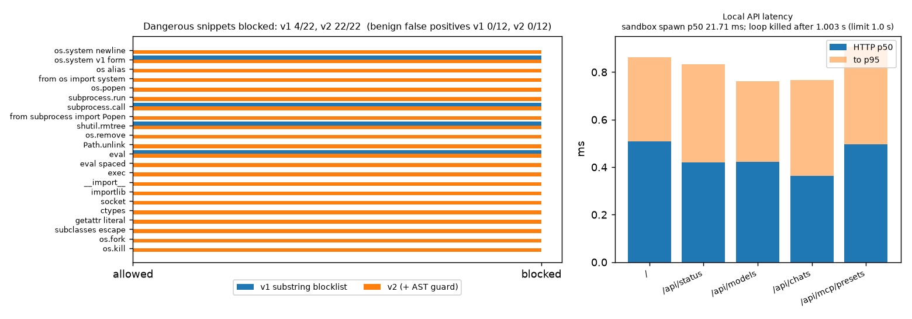
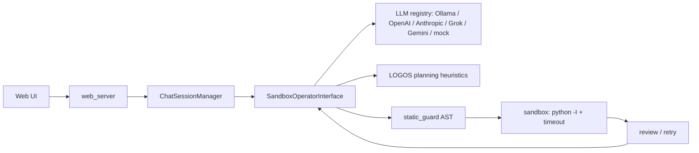

# Agent-IDE Sandbox

**A local multi-agent coding loop that plans, generates, guards, executes and reviews code.
It comes with a web UI, works with any LLM provider, and needs no third-party runtime
dependencies.**

[](https://github.com/Cyb0rg137ms/Agent-IDE-Sandbox-Multi-Agent-Software-Development-Environment/actions/workflows/ci.yml)

[](LICENSE)

<p align="center"></p>
<p align="center"><sub>Measured with <code>agent-ide-bench --requests 300</code> on an 8-vCPU Linux box with Python 3.13.5 and no model provider. Raw data is in <a href="docs/assets/bench.json">docs/assets/bench.json</a>.</sub></p>

## Why it matters

LLM-generated code runs on your machine, so what sits between the model and `python` matters.
This repo keeps that path small and measurable:

1. An AST guard rejects the common process, shell, network, FFI and dynamic-exec patterns.
2. Code runs in an isolated interpreter (`-I`) in a temp directory, with a hard timeout.
3. The results feed a review-and-retry loop.

The guard is defence in depth, not isolation. See [Limitations](#limitations-and-roadmap).

## Key results

| Metric | v1 (substring blocklist) | v2 (this PR) | Reproduce |
|---|---|---|---|
| Dangerous snippets blocked (22-case corpus) | **4 / 22** | **22 / 22** | `agent-ide-bench` → `guard` |
| Benign snippets wrongly blocked (12 cases) | 0 / 12 | 0 / 12 | same |
| Sandbox spawn, trivial script, p50 | n/a | 21.7 ms | same → `sandbox` |
| Infinite loop with a 1.0 s limit, killed after | n/a | 1.003 s | same |
| Pipeline overhead, mock provider (divide / fib / palindrome / snake) | n/a | 2.0 / 120.5 / 123.6 / 1.7 ms | same → `pipeline` |
| Local API p50 / p95: `/api/status` | n/a | 0.42 / 0.83 ms | same → `http` |
| Test suite | 129 tests (1 order-dependent failure) | 173 passed | `pytest -q` |

How to read these numbers:

- The attack corpus was written alongside the guard, so 22/22 is an in-sample regression check.
  A known bypass (a computed `getattr` name) is kept in the tests to keep that visible.
- The mock provider returns canned code. The pipeline numbers are orchestration time only and
  say nothing about model quality.

## Architecture



[docs/ARCHITECTURE.md](docs/ARCHITECTURE.md) has the detailed diagram.

## 60-second quickstart

```bash
git clone https://github.com/Cyb0rg137ms/Agent-IDE-Sandbox-Multi-Agent-Software-Development-Environment agent-ide
cd agent-ide && python -m venv .venv && . .venv/bin/activate
pip install -e ".[bench]"
python examples/guard_and_sandbox.py
agent-ide-bench --requests 50 --plot bench.png
agent-ide --provider mock --no-browser        # http://127.0.0.1:8000
```

For a real model, run `ollama serve` and pass `--provider ollama --model qwen2.5-coder:1.5b`.
For a cloud provider, set the provider's API key, for example `OPENAI_API_KEY`.

To run in Docker, which adds the real isolation the in-app runner lacks:

```bash
docker build -t agent-ide .
docker run --rm -p 127.0.0.1:8000:8000 --memory 1g --cpus 2 agent-ide
```

## Usage

```python
from agent_core.operator_interface import SandboxOperatorInterface

op = SandboxOperatorInterface(provider_name="mock", enable_logos=True)
report = op.solve_task("Write a safe division function divide(a, b).")
print(report.status, report.iterations, report.final_code)
```

```python
from agent_core.static_guard import scan

scan("from os import system as s\ns('id')")  # -> [Violation(line=1, rule='blocked-attr', ...), ...]
```

- `agent-ide [--host] [--port] [--provider] [--model] [--no-browser]` starts the server. The
  `--provider` and `--model` flags now configure the runtime; before this PR they were only
  printed.
- `agent-ide-bench [--requests N] [--sandbox-runs N] [--pipeline-repeats N] [--json F] [--plot F]`
  runs the benchmark.

## Design decisions and trade-offs

- **AST guard instead of regexes.** It catches aliases (`import os as o`), `from x import y`
  forms, spacing variants and literal `getattr` lookups. The trade-off is that it rejects
  `subprocess` and `socket` imports outright, which is right for generated snippets but can be
  turned off with `CodeExecutionSandbox(static_guard=False)` for trusted code.
- **`os` is not banned outright.** Only its dangerous attributes are. Benign `os.path` and
  `os.getcwd` usage still passes (0/12 false positives).
- **`python -I` with the temp dir as cwd.** This ignores `PYTHON*` env vars and user
  site-packages, and keeps relative writes inside the temp dir.
- **Zero runtime dependencies.** The project uses the standard library's `http.server` and
  `urllib`, so it is easy to audit but only suited to a single user.

## Limitations and roadmap

These are the main limitations. [docs/LIMITATIONS.md](docs/LIMITATIONS.md) has the full list.

- The in-app runner is not an OS sandbox.
- The guard is bypassable by dynamic tricks.
- There are no model-quality benchmarks.
- LOGOS layer names (MERA, holographic, NAS) are metaphors for heuristic planning code.
- There is no authentication, so keep it on loopback only.

Roadmap:

- a seccomp or container-backed runner by default
- a held-out guard red-team corpus
- task-suite benchmarks (for example HumanEval-style) against real providers
- removal of the mypy exclusions

## Citation

```bibtex
@software{agent_ide_sandbox,
  author = {Cyb0rg137ms},
  title  = {Agent-IDE Sandbox: a local multi-agent coding loop with a guarded executor},
  year   = {2026},
  url    = {https://github.com/Cyb0rg137ms/Agent-IDE-Sandbox-Multi-Agent-Software-Development-Environment}
}
```

## License

MIT. See [LICENSE](LICENSE).
